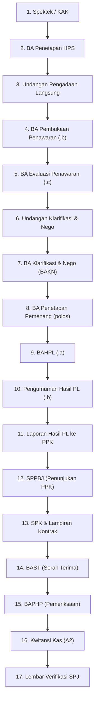

# PROJECT CONTEXT & SYSTEM ARCHITECTURE
**Sistem Informasi Administrasi Pengadaan & SPJ (AdminProc e-SPJ)**  
**RSUD dr. Soeratno Gemolong — Kabupaten Sragen**

> Dokumen ini adalah *System Handoff Document* resmi untuk pengembang perangkat lunak atau AI agent (Claude, GPT, Gemini) agar dapat langsung memahami konteks, arsitektur, skema data, alur bisnis, serta melanjutkan pengembangan tanpa redundansi atau kebingungan.

---

## 1. Ringkasan Sistem (Executive Summary)

### 1.1 Tujuan Aplikasi
Aplikasi **AdminProc e-SPJ** dirancang untuk mengotomasi seluruh siklus administrasi pengadaan barang/jasa dan pertanggungjawaban keuangan (Surat Pertanggungjawaban / SPJ) di lingkungan Badan Layanan Umum Daerah (BLUD) **RSUD dr. Soeratno Gemolong, Kabupaten Sragen**.

Sistem ini memangkas proses manual dan duplikasi input dengan prinsip **"Single Source of Truth"**: dari satu kali pengisian data paket pengadaan dan rekening belanja, sistem secara otomatis:
1. Memvalidasi pagu anggaran belanja (RBA).
2. Menghitung kalkulasi pajak daerah & negara (PPN 11%, PPh 22 1.5%, PPh 23) serta konversi angka ke kalimat terbilang bahasa Indonesia.
3. Mengatur penomoran dokumen otomatis berurutan sesuai buku register RSUD.
4. Menghasilkan (*generate*) seluruh berkas administrasi formal siap cetak dalam 2 format sekaligus: **PDF** (cetak instan) dan **Word DOCX** (arsip dinas yang dapat diedit).

### 1.2 Tech Stack Lengkap

| Lapisan | Teknologi | Versi | Keterangan & Peran |
| :--- | :--- | :--- | :--- |
| **Frontend Framework** | React | `^19.2.8` | Single Page Application (SPA), React 19 functional components |
| **Frontend Runtime / Bundler** | Vite | `^8.3.4` | Modern ESM bundler, Hot Module Replacement (HMR) |
| **Routing** | React Router DOM | `^7.18.4` | Declarative client-side routing |
| **Styling & UI** | Tailwind CSS v4 | `^4.3.3` | Utility-first CSS, plugin `@tailwindcss/vite` |
| **UI Icons** | Lucide React | `^1.58.0` | Iconography antarmuka pengguna |
| **Backend Runtime** | Node.js | `>=22.5.0` | Server-side JavaScript runtime environment |
| **Backend Framework** | Express | `^5.3.0` | Minimalist RESTful API engine |
| **Database Engine** | MySQL / MariaDB | `10.4+` | Standar Laragon / VPS kantor, port default `3306` |
| **Database Driver** | `mysql2/promise` | `^3.24.6` | Asynchronous MySQL driver dengan query-prepared statements |
| **Document Generator (PDF)** | PDFKit | `^0.20.2` | High-fidelity programmatic PDF rendering |
| **Document Generator (Word)** | `docx` | `^9.11.0` | OpenXML DOCX generator dengan tabel & layout dinas |
| **Spreadsheet Engine** | ExcelJS | `^4.4.0` | Impor realisasi RBA & ekspor rekapitulasi Excel |
| **Keamanan / Auth** | HMAC SHA256 & bcryptjs | `^3.0.3` | Stateless signed cookie session + hashing password |
| **File Upload** | Multer | `^2.4.0` | Penanganan berkas lampiran pendukung |

---

## 2. Arsitektur & Struktur Folder

Struktur proyek terpisah bersih (*decoupled*) antara `server` (Backend REST API) dan `web` (Frontend SPA):

```
adminproc/
├── .gitignore
├── package.json               # Root scripts (install:all, dev, build)
├── README.md                  # Quickstart panduan operasional
├── PROJECT_CONTEXT.md         # Dokumentasi arsitektur sistem ini
│
├── server/                    # Backend Service (Port 3001)
│   ├── .env                   # DB_HOST, DB_USER, DB_NAME, PORT, dsb.
│   ├── .env.example
│   ├── index.js               # Main API server, Auth, Transaksi REST, Routing Dokumen
│   ├── package.json
│   ├── assets/
│   │   └── logo/              # Logo Pemkab Sragen & RSUD dr. Soeratno Gemolong
│   └── lib/
│       ├── db.js              # MySQL connection pool, migrateSchema(), settings
│       ├── docs.js            # Dispatcher buatDokumen(), Engine Spektek, HPS, BAKN, SP, BAST, A2
│       ├── docs_pl.js         # Generator khusus 10 dokumen Pengadaan Langsung (50-750 Jt)
│       ├── import.js          # Impor data rekening RBA dari template Excel
│       └── util.js            # Terbilang Indonesia, hitungPajak(), tglIndo(), rupiah()
│
└── web/                       # Frontend SPA (Port 5173 dev / dist production)
    ├── index.html             # HTML entry point
    ├── vite.config.js         # Konfigurasi Vite & proxy ke port 3001
    ├── package.json
    └── src/
        ├── main.jsx           # Mounting React DOM
        ├── App.jsx            # Layout induk, sidebar menu, context auth & routing
        ├── ui.jsx             # Reusable UI kit (Button, Input, Modal, Badge, Stepper)
        ├── lib.js             # Client helpers (formatter, api wrapper, kalkulator)
        ├── index.css          # Styling kustom & font inter/serif dinas
        └── pages/
            ├── Dashboard.jsx      # Metrik belanja, pagu RBA, quick action tier
            ├── Transaksi.jsx      # Tabel daftar SPJ, filter status/tier, print hub
            ├── TransaksiForm.jsx  # Multi-step master wizard untuk semua tier pengadaan
            ├── Rekening.jsx       # Manajemen rekening belanja & pagu anggaran
            ├── Pejabat.jsx        # Master data PPKom, Pejabat Pengadaan, PPTK, KPA
            ├── Penyedia.jsx       # Rekanan/Vendor (CV/PT, NPWP, Bank, Rekening)
            ├── Pengguna.jsx       # Manajemen user & role admin/staf
            ├── Pengaturan.jsx     # Setting instansi, tahun anggaran, kop surat
            └── Login.jsx          # Autentikasi sesi
```

### 2.1 Alur Data dan Pembagian Tier Pengadaan

Sistem mengadopsi segmentasi pengadaan pemerintah berdasarkan pagu nilai transaksi (`mode_pengadaan`):

```
┌────────────────────────────────────────────────────────────────────────┐
│                        MODE PENGADAAN SPJ                              │
├───────────────────┬───────────────────┬────────────────────────────────┤
│ 1. Langsung A2    │ Belanja langsung  │ A2 + Lembar Verifikasi         │
│                   │ non-kontraktual   │ (2 Dokumen)                    │
├───────────────────┼───────────────────┼────────────────────────────────┤
│ 2. Tier 0–2 Jt &  │ Nilai kecil       │ Surat Pesanan (SP)             │
│    Tier 2–10 Jt   │ (0–10 Juta)       │ → BAST → BAPHP → A2 → Verif    │
│    (`0_10`)       │                   │ (5 Dokumen)                    │
├───────────────────┼───────────────────┼────────────────────────────────┤
│ 3. Tier 10–50 Jt  │ Pengadaan         │ 1. Spektek/KAK → 2. HPS        │
│    (`10_50`)      │ Langsung          │ → 3. BA Klarifikasi & Nego     │
│                   │ Sederhana         │ → 4. SP → 5. BAST → 6. BAPHP   │
│                   │                   │ → 7. A2 → 8. Lembar Verifikasi │
│                   │                   │ (8 Dokumen)                    │
├───────────────────┼───────────────────┼────────────────────────────────┤
│ 4. Tier 50–750 Jt │ Pengadaan         │ 17 Dokumen Formal Lengkap      │
│    (`50_750`)     │ Langsung          │ (Surat Pesanan diganti SPK,    │
│                   │ Penuh             │ SPPBJ terbit sebelum SPK)      │
└───────────────────┴───────────────────┴────────────────────────────────┘
```

---

## 3. Status Modul & Skema Data Saat Ini

### 3.1 Skema Database (`db_spj_proc`)

Migrasi skema dikelola secara otomatis dan non-destruktif oleh fungsi `migrateSchema()` pada file [`server/lib/db.js`](file:///d:/wpu-course/adminproc/server/lib/db.js).

#### Tabel Utama: `transaksi`
Menyimpan seluruh data siklus pengadaan dari awal hingga selesai:

| Kolom | Tipe Data | Deskripsi |
| :--- | :--- | :--- |
| `id` | `INT AUTO_INCREMENT PRIMARY KEY` | Identitas unik transaksi |
| `tanggal` | `DATE` | Tanggal dokumen induk |
| `rekening_id` | `INT NOT NULL` | Foreign key ke tabel `rekening` (RBA belanja) |
| `penyedia` | `VARCHAR(255)` | Nama rekanan (CV / PT / Toko) |
| `penyedia_id` | `INT NULL` | Relasi ke master penyedia |
| `penyedia_pimpinan` | `VARCHAR(255)` | Nama direktur / penanggung jawab rekanan |
| `penyedia_jabatan` | `VARCHAR(100)` | Jabatan pimpinan (default: *Direktur*) |
| `penyedia_alamat` | `TEXT` | Alamat resmi penyedia |
| `penyedia_npwp` | `VARCHAR(100)` | NPWP rekanan |
| `uraian` | `TEXT` | "Yaitu untuk pembayaran / Uraian Pekerjaan" |
| `kotor` | `BIGINT` | Nilai total transaksi (bruto) |
| `ppn_aktif` | `TINYINT(1)` | Switch apakah dikenakan PPN (11%) |
| `pph_aktif` | `TINYINT(1)` | Switch apakah dikenakan PPh 22 (1.5%) / 23 |
| `ppn_tarif` | `DECIMAL(5,2)` | Tarif PPN aktif |
| `pph_tarif` | `DECIMAL(5,2)` | Tarif PPh aktif |
| `ppn_nominal` | `BIGINT` | Hasil hitung rupiah PPN |
| `pph_nominal` | `BIGINT` | Hasil hitung rupiah PPh |
| `bersih` | `BIGINT` | Nilai bersih yang diterima penyedia (`kotor - pph`) |
| `kategori` | `VARCHAR(20)` | String label rentang nilai |
| `mode_pengadaan` | `VARCHAR(30)` | Mode: `'0_10'`, `'10_50'`, `'50_750'` |
| `tahap` | `VARCHAR(30)` | Status progress: `'spektek'`, `'hps'`, `'undangan'`, `'evaluasi'`, `'negosiasi'`, `'penetapan'`, `'kontrak'`, `'pesanan'`, `'selesai'`, `'spj_langsung'` |
| `kpa_id` | `INT NULL` | ID Kuasa Pengguna Anggaran |
| `ppkom_id` | `INT NULL` | ID Pejabat Pembuat Komitmen (PPKom) |
| `pptk_id` | `INT NULL` | ID Pejabat Pelaksana Teknis Kegiatan (PPTK) |
| `pengadaan_id` | `INT NULL` | ID Pejabat Pengadaan |
| `bendahara_id` | `INT NULL` | ID Bendahara Pengeluaran Pembantu |
| `verifikator_id` | `INT NULL` | ID Petugas Verifikasi SPJ |
| `pengurus_barang_id` | `INT NULL` | ID Pengurus Barang Penerima Hasil Pekerjaan |
| `spektek_json` | `LONGTEXT NULL` | JSON metadata KAK (latar belakang, maksud, spesifikasi, lokasi, dsb.) |
| `spektek_no_urut` | `VARCHAR(50)` | Nomor urut register Spektek |
| `spektek_nomor` | `VARCHAR(120)` | Format nomor resmi Spektek (`027/.../05.2.12/2026`) |
| `spektek_tanggal` | `DATE NULL` | Tanggal penetapan Spektek |
| `hps_no_urut` | `VARCHAR(50)` | Nomor urut register HPS |
| `hps_nomor` | `VARCHAR(120)` | Format nomor resmi HPS |
| `hps_tanggal` | `DATE NULL` | Tanggal penetapan HPS |
| `hps_total` | `BIGINT DEFAULT 0` | Total akumulasi HPS |
| `bakn_no_urut` | `VARCHAR(50)` | Nomor urut register Berita Acara Klarifikasi & Negosiasi |
| `bakn_nomor` | `VARCHAR(120)` | Format nomor resmi BAKN |
| `bakn_tanggal` | `DATE NULL` | Tanggal pelaksanaan negosiasi |
| `penawaran_total` | `BIGINT DEFAULT 0` | Total harga penawaran rekanan sebelum negosiasi |
| `harga_penawaran_penyedia`| `BIGINT DEFAULT 0`| Input penawaran manual dari penyedia |
| `bakn_hasil_teknis`| `VARCHAR(255)` | Keterangan evaluasi teknis |
| `sp_no_urut` | `VARCHAR(50)` | Nomor urut Surat Pesanan (untuk alur 0–50 Jt) |
| `sp_nomor` | `VARCHAR(120)` | Nomor resmi Surat Pesanan |
| `sp_tanggal` | `DATE NULL` | Tanggal Surat Pesanan |
| `sp_tgl_kirim` | `DATE NULL` | Batas waktu pengiriman barang SP |
| `spk_no_urut` | `VARCHAR(50)` | Nomor urut Surat Perintah Kerja (untuk alur 50–750 Jt) |
| `spk_nomor` | `VARCHAR(120)` | Nomor resmi SPK Kontrak |
| `spk_tanggal` | `DATE NULL` | Tanggal penandatanganan SPK |
| `bast_no_urut` | `VARCHAR(50)` | Nomor urut Berita Acara Serah Terima |
| `bast_nomor` | `VARCHAR(120)` | Nomor resmi BAST |
| `bast_tanggal` | `DATE NULL` | Tanggal BAST |
| `baphp_no_urut` | `VARCHAR(50)` | Nomor urut BA Pemeriksaan Hasil Pekerjaan |
| `baphp_nomor` | `VARCHAR(120)` | Nomor resmi BAPHP |
| `baphp_tanggal` | `DATE NULL` | Tanggal BAPHP |
| `no_urut_dokumen` | `VARCHAR(50)` | Nomor urut Kwitansi A2 |
| `nomor` | `VARCHAR(120)` | Nomor resmi Kwitansi A2 |
| `pl_json` | `LONGTEXT NULL` | JSON terstruktur seluruh parameter Pengadaan Langsung 50–750 Jt |

#### Struktur Metadata `pl_json`
Menyimpan konfigurasi khusus alur Pengadaan Langsung:
```json
{
  "pejabat_nama": "AGUS SUBAGYO, S.T., M.M.",
  "pejabat_nip": "19780512 200501 1 008",
  "ppk_nama": "dr. KINIK DARSONO, M.Pd.Ked.",
  "ppk_nip": "19730310 200212 1 004",
  "direktur_nama": "dr. KINIK DARSONO, M.Pd.Ked.",
  "pembukaan_no_urut": "2573.b",
  "pembukaan_nomor": "027/2573.b/05.2.12/2026",
  "evaluasi_no_urut": "2573.c",
  "evaluasi_nomor": "027/2573.c/05.2.12/2026",
  "penetapan_no_urut": "2656",
  "penetapan_nomor": "027/2656/05.2.12/2026",
  "bahpl_no_urut": "2656.a",
  "bahpl_nomor": "027/2656.a/05.2.12/2026",
  "pengumuman_no_urut": "2656.b",
  "pengumuman_nomor": "027/2656.b/05.2.12/2026",
  "jadwal": {
    "pemasukan_mulai": "2026-05-05",
    "pemasukan_sampai": "2026-05-07",
    "pembukaan": "2026-05-08",
    "klarifikasi": "2026-05-09",
    "penetapan": "2026-05-11",
    "penandatanganan_spk": "2026-05-18"
  },
  "dokumen_penawaran_surat": "015/BSE-P/V/2026",
  "dokumen_penawaran_tgl": "2026-05-06",
  "harga_penawaran": 128000000,
  "klarifikasi_no_urut": "2574",
  "klarifikasi_nomor": "027/2574/05.2.12/2026",
  "klarifikasi_tanggal": "2026-05-08",
  "klarifikasi_waktu": "09:00 WIB",
  "klarifikasi_tempat": "Ruang Pejabat Pengadaan RSUD dr. Soeratno Gemolong",
  "klarifikasi_unsur": "Kesesuaian teknis motor, ketebalan drum stainless steel, sistem 3 phase.",
  "bahpl_tanggal": "2026-05-11",
  "pengumuman_tanggal": "2026-05-11",
  "laporan_no_urut": "2657",
  "laporan_nomor": "027/2657/05.2.12/2026",
  "laporan_tanggal": "2026-05-12",
  "sppbj_no_urut": "2660",
  "sppbj_nomor": "027/2660/05.2.12/2026",
  "sppbj_tanggal": "2026-05-13",
  "spk_lampiran_no_urut": "2673.a",
  "spk_lampiran_nomor": "027/2673.a/05.2.12/2026",
  "spk_waktu_penyelesaian": "14 (Empat Belas) Hari Kalender",
  "spk_tanggal_mulai": "2026-05-18",
  "spk_tanggal_selesai": "2026-05-31"
}
```

#### Tabel Rincian: `transaksi_item`
Menampung multi-item rincian barang/jasa dalam setiap transaksi:
- `id`, `transaksi_id`, `urut`
- `jenis_barang` (nama barang/pekerjaan)
- `spesifikasi` (spesifikasi teknis detail)
- `satuan` (Unit, Buah, Rim, Paket, dsb.)
- `kuantitas`
- `harga_hps` (harga satuan HPS)
- `harga_penawaran` (harga penawaran vendor)
- `harga_satuan` (harga final hasil negosiasi / kontrak)
- `harga_total` (`kuantitas * harga_satuan`)

---

## 4. Mekanisme Document Generator (PDF & DOCX)

### 4.1 Routing & Dispatcher Universal
Semua dokumen diakses melalui satu endpoint seragam:
```http
GET /api/transaksi/:id/dokumen/:jenis.:format
```
- `:id` = ID transaksi di database.
- `:jenis` = Identifier dokumen (contoh: `spektek`, `hps`, `undangan_pl`, `ba_pembukaan`, `spk`, `bast`, `a2`, dll).
- `:format` = `pdf` atau `docx`.

Di backend, fungsi `buatDokumen(id, jenis, format)` pada [`server/lib/docs.js`](file:///d:/wpu-course/adminproc/server/lib/docs.js) mengekstrak data gabungan (`t`, `rek`, `items`, `spektek`, `pl`, `pejabat`) via `ambilData(id)` lalu mendelegasikannya ke generator bersangkutan.

### 4.2 Standar Layout & Tipografi
1. **Header & Kop Dokumen**:
   - Logo Pemkab Sragen di sisi kiri, Logo RSUD dr. Soeratno Gemolong di sisi kanan.
   - Teks kop surat resmi:
     ```
     PEMERINTAH KABUPATEN SRAGEN
     RUMAH SAKIT UMUM DAERAH dr. SOERATNO GEMOLONG
     Alamat: Jl. R Ngt. Tjitrosantjoko No. 10 Gemolong, Sragen 57274
     ```
2. **Kepatuhan Format Legal**:
   - Menggunakan tanda tangan Pejabat Pengadaan, PPKom, dan Rekanan sesuai regulasi.
   - Kalimat terbilang otomatis (`terbilang(nominal)`).
   - Tanggal formal Indonesia (`tglIndo(date)` dan `tglKalimatBast(date)` yang mengeja hari, tanggal, bulan, tahun).

---

## 5. Implementasi & Rencana Tier 50–750 Juta

### 5.1 Urutan 17 Dokumen Resmi (Exact Flow)
Pada pengadaan Tier 50–750 Juta, urutan dokumen adalah sebagai berikut:



> **Keputusan Arsitektur Kritis:**
> 1. **SPPBJ terbit dahulu sebelum SPK**: Pejabat Pembuat Komitmen (PPKom) menerbitkan Surat Penunjukan Penyedia Barang/Jasa (SPPBJ), setelah itu barulah Surat Perintah Kerja (SPK) ditandatangani.
> 2. **Surat Pesanan (SP) diganti SPK**: Pada alur 50–750 Juta, instrumen kontrak resmi adalah SPK. Dokumen SP tidak dipakai. BAST dan BAPHP merujuk ke nomor dan tanggal SPK.
> 3. **Single Vendor**: Proses Pengadaan Langsung BLUD ini mengevaluasi 1 penyedia undangan.
> 4. **Pelaksana Pemilihan**: Dilaksanakan oleh **Pejabat Pengadaan** (bukan panitia kelompok kerja).

### 5.2 Logika Penomoran Sufiks Induk (Automatic Suffixing)
Penomoran register dokumen RSUD dr. Soeratno Gemolong memiliki aturan sufiks:
1. **Kelompok Pembukaan & Evaluasi**:
   - Nomor induk evaluasi (contoh `2573`) otomatis menurunkan nomor Berita Acara Pembukaan menjadi `2573.b` dan Berita Acara Evaluasi menjadi `2573.c`.
2. **Kelompok Penetapan & Pengumuman**:
   - Nomor induk penetapan (contoh `2656`) otomatis menurunkan nomor BA Penetapan menjadi `2656` (polos), BAHPL menjadi `2656.a`, dan Pengumuman menjadi `2656.b`.
3. **Kelompok SPK Kontrak**:
   - Nomor induk SPK (contoh `2673`) otomatis menurunkan Lampiran Rincian Barang SPK menjadi `2673.a`.

### 5.3 Validasi Kronologi Tanggal (Sequential Date Enforcement)
Untuk menjaga keabsahan audit BPK/Inspektorat, urutan tanggal dokumen harus memenuhi relasi kronologis:
$$\text{Spektek} \le \text{HPS} \le \text{Undangan PL} \le \text{Pemasukan Penawaran} \le \text{Pembukaan} \le \text{Klarifikasi/Nego} \le \text{Penetapan} \le \text{SPPBJ} \le \text{SPK} \le \text{BAST/BAPHP} \le \text{A2/Verifikasi}$$

---

## 6. Titik Integrasi Kode (Code Touchpoints)

Bagi pengembang yang akan memodifikasi atau menambah fitur, berikut adalah berkas-berkas sentral:

1. **[`server/lib/docs_pl.js`](file:///d:/wpu-course/adminproc/server/lib/docs_pl.js)**:
   - Berisi fungsi generator PDF & DOCX untuk 10 dokumen khusus Pengadaan Langsung:
     `undanganPlPdf`, `undanganPlDocx`, `baPembukaanPdf`, `baPembukaanDocx`, `baEvaluasiPdf`, `baEvaluasiDocx`, `undanganKlarifikasiPdf`, `undanganKlarifikasiDocx`, `baPenetapanPdf`, `baPenetapanDocx`, `bahplPdf`, `bahplDocx`, `pengumumanPlPdf`, `pengumumanPlDocx`, `laporanPlPdf`, `laporanPlDocx`, `sppbjPdf`, `sppbjDocx`, `spkPdf`, `spkDocx`.

2. **[`server/lib/docs.js`](file:///d:/wpu-course/adminproc/server/lib/docs.js)**:
   - Hub pusat (`buatDokumen` dan `ambilData`). Memetakan nama dokumen ke fungsi generator di `docs_pl.js` atau generator lokal (BAST, BAPHP, A2, Spektek, HPS).

3. **[`server/lib/db.js`](file:///d:/wpu-course/adminproc/server/lib/db.js)**:
   - Menangani pool koneksi MySQL dan fungsi `migrateSchema()` yang menambahkan kolom baru seperti `pl_json`, `spk_no_urut`, `spk_nomor`, dan `spk_tanggal`.

4. **[`server/index.js`](file:///d:/wpu-course/adminproc/server/index.js)**:
   - API endpoints:
     - `POST /api/transaksi` & `PUT /api/transaksi/:id` (fungsi `bacaTrx` memvalidasi dan mem-parse field transaksi).
     - `GET /api/penomoran/next` (penghitung nomor otomatis per buku register induk).
     - `GET /api/transaksi/:id/dokumen/:jenis.:format` (streaming berkas PDF/DOCX ke browser).

5. **[`web/src/pages/TransaksiForm.jsx`](file:///d:/wpu-course/adminproc/web/src/pages/TransaksiForm.jsx)**:
   - Master wizard form. Mengatur state dinamis 8 tahapan untuk alur `50_750`:
     - Step 1: Spektek / KAK
     - Step 2: BA Penetapan HPS
     - Step 20: Undangan PL & Jadwal 5 Kegiatan
     - Step 21: Pembukaan & Evaluasi Penawaran
     - Step 11: Undangan, Klarifikasi Teknis & Negosiasi
     - Step 22: Penetapan Pemenang, BAHPL, Pengumuman & Laporan ke PPK
     - Step 23: Penerbitan SPPBJ & Kontrak SPK
     - Step 2: BAST, BAPHP, A2, dan Lembar Verifikasi

6. **[`web/src/pages/Transaksi.jsx`](file:///d:/wpu-course/adminproc/web/src/pages/Transaksi.jsx)**:
   - Daftar tabel transaksi. Mengatur tombol cetak cepat 17 dokumen, badge tahap alur, dan filter tier.

7. **[`web/src/ui.jsx`](file:///d:/wpu-course/adminproc/web/src/ui.jsx)**:
   - Berisi menu cepat `BuatDokumenMenu` dengan 4 pilihan tier bersih dan elegan.

---

## 7. Prosedur Menjalankan Sistem (Developer Guide)

### 7.1 Menjalankan Server & Client
```powershell
# 1. Jalankan Backend (Port 3001)
npm start --prefix server

# 2. Jalankan Frontend Vite Dev (Port 5173)
npm run dev --prefix web

# 3. Build Production Frontend
npm run build --prefix web
```

### 7.2 Menjalankan Uji Otomatis Dokumen (Regression Test)
Jika melakukan perubahan pada generator dokumen di `docs.js` atau `docs_pl.js`, jalankan script verifikasi untuk memastikan seluruh 17 dokumen ter-generate tanpa corrupt:
```powershell
node -e "
const { buatDokumen } = require('./server/lib/docs');
// Test harness memanggil buatDokumen(id, jenis, 'pdf') & ('docx')
"
```

---
*Dokumen ini diperbarui secara otomatis pada siklus rilis implementasi Tier 50–750 Juta AdminProc e-SPJ RSUD dr. Soeratno Gemolong.*
